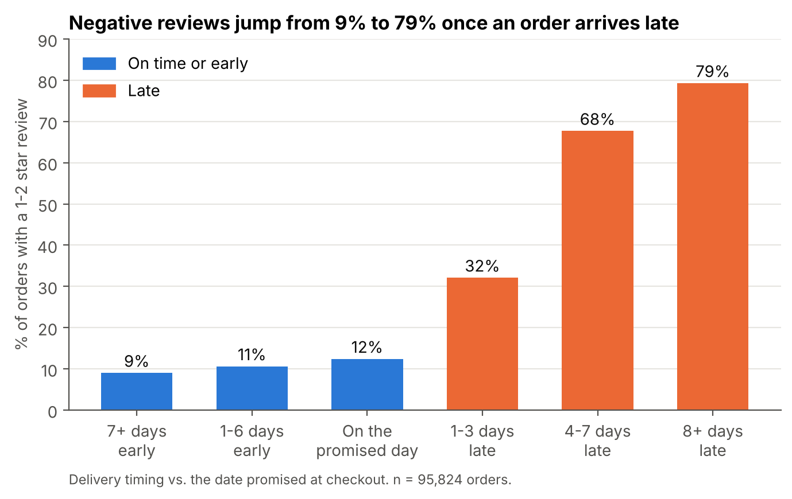
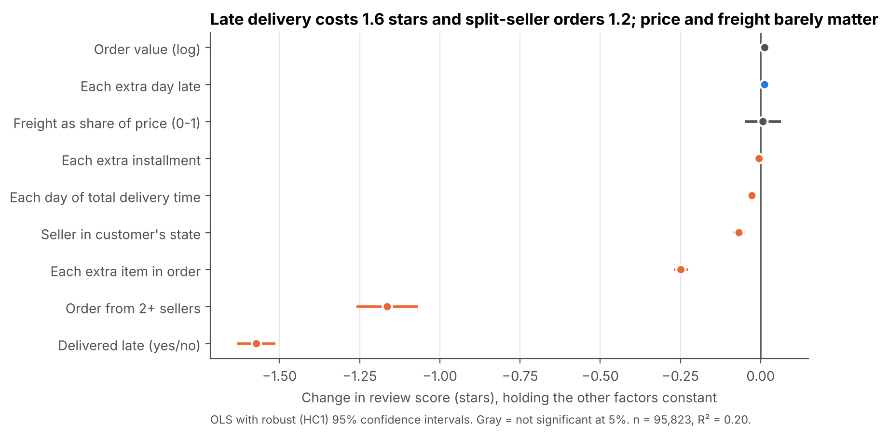
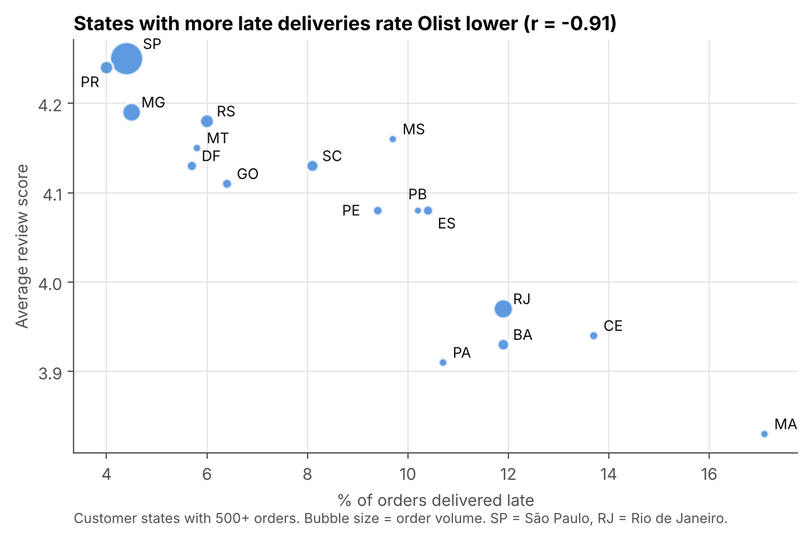
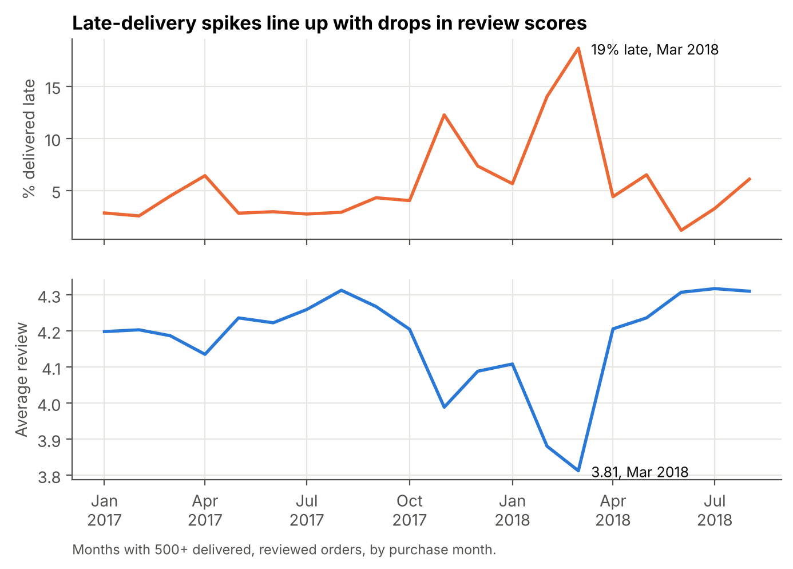

# What Drives Customer Satisfaction in E-Commerce?
### SQL + Python analysis of 95,824 Olist marketplace orders

**Business question:** Which parts of the customer experience drive 1- and 2-star reviews, and where should operations focus first?

**Tools:** SQL (SQLite: CTEs, window functions, multi-table joins) · Python (pandas, NumPy, SciPy, matplotlib) · Jupyter

**Data:** [Brazilian E-Commerce Public Dataset by Olist](https://www.kaggle.com/datasets/olistbr/brazilian-ecommerce): about 100,000 real, anonymized orders from 2016–2018 across 9 related tables (orders, items, payments, reviews, customers, sellers, products).

---

## Key findings

| # | Finding | Evidence |
|---|---|---|
| 1 | **Late delivery is the #1 driver of bad reviews** | Late orders are 6.7% of volume but 32.5% of all 1–2 star reviews (62% vs. 9% negative rate) |
| 2 | **Missing the promise matters more than speed** | Being late costs 1.6 stars in the regression; total delivery time costs only 0.03 stars per day |
| 3 | **Split-seller orders are a hidden problem** | Orders from 2+ sellers are 1.3% of volume but get 47% negative reviews; 57% of their negative comments mention missing or partial items |
| 4 | **Lateness is concentrated in the Northeast and Rio de Janeiro** | MA, CE, BA and RJ have 12–17% late rates vs. 4% in São Paulo; state late rate and average review correlate at r = −0.91 |
| 5 | **8 high-volume sellers need an operations review** | Late and negative-review rates both 1.5x+ the marketplace average (avg. review 3.54 vs. 4.13) |

**Impact:** if late orders were reviewed like on-time orders, negative reviews would fall by about **3,400 (28%)**, from 12.8% to 9.3% of orders.









## Recommendations

1. **Protect the promised date in high-risk states.** Add buffer to delivery estimates and prioritize carriers for MA, CE, BA, PA and RJ.
2. **Fix the split-order experience.** Tell customers up front that items ship separately, send the review request only after the *last* package arrives, and show per-package tracking.
3. **Send proactive delay alerts** before a promised date is missed.
4. **Start seller operations reviews** with the 8 flagged sellers, and tie search ranking to on-time performance.

---

## How the analysis works

```
CSV files (9 tables)
   │  src/build_database.py        load into SQLite, index join keys
   ▼
sql/01_data_quality_checks.sql      row counts, statuses, duplicate reviews, missing values
sql/02_order_level_dataset.sql      7-table join → 1 row per delivered, reviewed order
   ▼
sql/03_late_delivery_impact.sql     reviews by days early/late (CASE buckets, window %)
sql/04_state_performance.sql        late rate and reviews by state (HAVING, RANK)
sql/05_category_performance.sql     revenue, freight, lateness by category
sql/06_seller_scorecard.sql         seller benchmark vs. marketplace (CTE, CROSS JOIN, RANK)
   ▼
notebooks/analysis.ipynb            pandas: regression, chi-square test, text check, charts, impact estimate
```

**SQL highlights**
- **Avoiding join fan-out:** items, payments and reviews each have many rows per order, so each is collapsed to one row per order in its own CTE *before* joining. The notebook asserts that `order_id` is unique after the join.
- **Window functions:** `ROW_NUMBER()` keeps the latest of duplicate reviews (547 orders) and picks each order's main item and payment type; `SUM() OVER ()` computes percent of total; `RANK()` ranks states and sellers.
- **Performance:** `MATERIALIZED` CTEs brought the 7-table join from minutes to about 3 seconds.

**Python highlights**
- OLS regression of review score on 9 order characteristics with robust (HC1) standard errors, written in NumPy so the math is visible (`src/helpers.py`). R² = 0.20, n = 95,823.
- Chi-square test of late vs. on-time negative-review rates.
- Keyword check of Portuguese review comments to test *why* split-seller orders score badly.
- Counterfactual estimate of negative reviews avoided.

## Data quality notes

- Kept only **delivered** orders with a delivery date and a review (95,824 of 99,441 orders).
- **547 orders had 2+ reviews**; the latest one is kept.
- **610 products have no category**; they're labeled `unknown`.
- "Late" means delivered on a later calendar day than the estimated delivery date shown at purchase.

**Limitations:** observational data, so these are associations, not proven causes. Reviews are self-selected, the comment keyword check is approximate, and the data ends in 2018.

---

## Run it yourself

```bash
git clone https://github.com/alcarrui-spec/olist-customer-satisfaction.git
cd olist-customer-satisfaction
pip install -r requirements.txt
```

1. Download the dataset from [Kaggle](https://www.kaggle.com/datasets/olistbr/brazilian-ecommerce) ("Download dataset as zip") and unzip the CSV files into `data/raw/`.
2. Build the database: `python src/build_database.py`
3. Open and run the notebook: `jupyter notebook notebooks/analysis.ipynb`

The SQL files also run on their own in any SQLite client, such as DB Browser for SQLite. Run `02_order_level_dataset.sql` as `CREATE TABLE order_level AS <query>` first, because files 03–06 use that table.

## Repository structure

```
├── data/raw/              CSVs go here (not committed; download from Kaggle)
├── images/                charts used in this README
├── notebooks/
│   └── analysis.ipynb     full analysis with outputs
├── sql/                   01–06 SQL queries
├── src/
│   ├── build_database.py  loads CSVs into SQLite
│   └── helpers.py         SQL runner + OLS regression
└── requirements.txt
```

**Data license:** the Olist dataset is published on Kaggle under CC BY-NC-SA 4.0. It is used here for non-commercial analysis with attribution to Olist.

**Author:** Adriana Carruitero · [LinkedIn](https://www.linkedin.com/in/adriana-carruitero) · M.S. Business Analytics, Syracuse University
